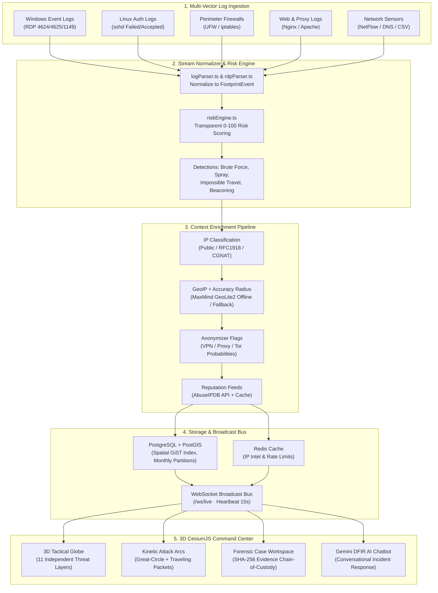

# CyberTrace Globe — Real-Time 3D Network Threat Intelligence & Digital Forensics Command Center

[](LICENSE)
[](https://cesium.com)
[](https://ai.google.dev/)
[](https://www.typescriptlang.org/)
[](https://developer.mozilla.org/en-US/docs/Web/API/WebSockets_API)
[](https://en.wikipedia.org/wiki/SHA-2)

**CyberTrace Globe** is an instrument-grade, dark-themed 3D geospatial cyber threat intelligence and digital forensics command center. Engineered on **CesiumJS**, **React 19**, **Express / FastAPI**, **WebSockets (`/ws/live`)**, **PostgreSQL + PostGIS**, and **Google Gemini**, the platform ingests, normalizes, enriches, and correlates network footprints (SSH bursts, Windows RDP intrusions, UFW firewall drops, web path scanning, DNS tunneling, NetFlow spikes) in real time.

---

## Visual Tour & Command Center Interface

### 1. 3D Geospatial Threat Globe & Kinetic Attack Arcs
Real-time great-circle geodesic attack arcs, confidence radius uncertainty circles, and live telemetry feeds across tactical command vantage points.


### 2. Forensic IP & Network Attribution Inspector
Slide-out telemetry inspector displaying approximate network leads, ASN data, VPN/Proxy/Tor probability bars, transparent risk factor contributions, and one-click firewall actions.


### 3. Gemini DFIR AI Forensic Analyst & Interactive Chatbot
Conversational multi-turn DFIR investigation assistant grounded in active telemetry. Separates verified log evidence, correlation inferences, and simulated demo data with actionable containment guidance.


### 4. Digital Forensics Case Management & SHA-256 Evidence Vault
Full investigation case workspaces featuring immutable chain-of-custody tracking, cryptographic SHA-256 evidence hashing, and timestamped investigator notes.


### 5. Multi-Source Log Ingestion Pipeline
High-speed log normalizer supporting Windows Security (4624/4625), TerminalServices (1149), SSH auth, UFW/iptables, Nginx, DNS query logs, NetFlow CSV, and JSONL.


### 6. Global Analytics & Geographic Risk Matrix
Macro-level threat posture dashboard showing category breakdowns, regional risk rankings, top originating ASNs, and egress protocol distributions.


### 7. Responsive Tactical Command Layout
Full command-and-control operations adapted for mobile field operations, command tablets, and wall displays.


---

## Core System Architecture



---

## How the Platform Works

### 1. Ingestion & Normalization (`src/lib/logParser.ts` & `src/lib/rdpParser.ts`)
Raw log batches received via `POST /api/logs/ingest` or live sensor streams are normalized into structured `FootprintEvent` records. Every record generates a deterministic SHA-256 hash of the original raw line for evidence integrity. Private RFC1918 addresses are masked (e.g., `10.14.x.12 (internal-masked)`).

### 2. Multi-Vector RDP & SSH Threat Detection (`src/lib/rdpParser.ts`)
Specialized detection rules continuously correlate incoming footprints:
- **Brute Force:** Triggered when $\ge 10$ authentication failures occur from a single IP within 5 minutes. Severity scales with distinct target accounts.
- **Password Spray:** Flags single IPs targeting $\ge 5$ distinct usernames with low attempt volumes per account.
- **Success After Failures (Critical):** Detects authentication bursts (`EventID 4625`) immediately followed by successful logon (`EventID 4624 LogonType 10` or `1149`).
- **Impossible Travel:** Flags single users authenticating from distant geographic points with implied transit speeds exceeding 900 km/h, accounting for uncertainty radii.
- **Distributed Attacks:** Detects coordinated sweeps across $\ge 10$ unique IPs targeting a protected asset.

### 3. Transparent Risk Scoring Engine (`src/lib/riskEngine.ts`)
Risk is never a black box. Scores (0–100) are computed dynamically across weighted factors:
- **Threat Reputation:** Up to 28 pts based on verified external abuse score
- **Authentication Failure Intensity:** Up to 24 pts based on failure volume
- **C2 Beacon Indicators:** Up to 28 pts for periodic outbound command-and-control heartbeats
- **Outbound Exfiltration Volume:** Up to 28 pts for anomalous data transfers
- **Network Anonymization Risk:** Up to 12 pts for Tor exit nodes, proxies, and commercial VPN egress
- **Reconnaissance Intensity:** Up to 16 pts for multi-port scanning sweeps

### 4. Interactive 3D CesiumJS Rendering (`src/components/CyberGlobe.tsx`)
The globe employs custom CesiumJS rendering tuned for instrument-grade SOC monitoring:
- **Kinetic Attack Arcs:** Great-circle arcs computed with peak altitude $h = \text{clamp}(0.22 \times \text{distance}, 180\text{ km}, 2600\text{ km})$ with traveling packet animations.
- **Confidence Radius Rings:** Ground circles represent the exact geolocation uncertainty radius (in km), preventing false assumptions about attacker physical locations.
- **11 Independent Layers:** Toggle Attack Sources, Protected Assets, Attack Arcs, Port Scans, Brute Force, Malware C2, Data Exfiltration, VPN/Tor, Reputation, Heatmaps, and the Geo Risk Matrix.

### 5. Gemini DFIR AI Forensic Chatbot (`src/components/ForensicAnalystView.tsx`)
The integrated Gemini DFIR Assistant operates in dual modes:
- **Interactive Multi-Turn Chat:** Live dialog with the AI analyst to correlate IPs, evaluate kill-chain progression, and receive tactical containment steps.
- **Automated Assessment Brief:** Generates structured JSON reports separating **Verified Telemetry Facts**, **Correlation Inferences**, and **DEMO DATA** notices.
- **One-Click Case Integration:** Save AI findings directly into active case notes with audit-logged chain of custody.

---

## Non-Negotiable Forensic Ground Rules

1. **Defensive & Investigative Use Only:** The platform monitors authorized assets. It never scans, probes, or exploits third-party systems.
2. **Approximate Geolocation Only:** Every IP marker displays an explicit confidence radius circle in kilometers alongside the mandatory legal notice:
   > *"Approximate network location · Investigative lead only — not proof of a person's physical location or identity."*
3. **Anonymizer Awareness:** VPN, proxy, Tor, and CGNAT connections are labeled with probabilities. The platform never claims to "unmask" individuals behind shared egress points.
4. **Evidence Integrity (SHA-256):** Uploaded evidence and raw logs are cryptographically hashed using SHA-256. Audit trails and evidence records are strictly append-only.
5. **Honest Data:** Simulated scenarios are visibly labeled `DEMO DATA` in badges, tooltips, exports, and AI analysis.
6. **Zero Secrets in Client:** API keys (`GEMINI_API_KEY`, `ABUSEIPDB_API_KEY`) remain strictly server-side.

---

## Quick Start & Installation

### Option A: Local Node.js Full-Stack (Recommended)

1. **Clone the repository:**
   ```bash
   git clone https://github.com/your-org/cybertrace-globe.git
   cd cybertrace-globe
   ```

2. **Install dependencies:**
   ```bash
   npm install --legacy-peer-deps
   ```

3. **Configure environment:**
   Create a `.env` file in the root directory:
   ```env
   PORT=3000
   APP_URL=http://localhost:3000
   DEMO_MODE=true
   GEMINI_API_KEY=your_gemini_api_key_here
   ```

4. **Launch the development server:**
   ```bash
   npm run dev
   ```
   Open **`http://localhost:3000`** in Chrome, Edge, or Firefox.

---

### Option B: Self-Hosted Docker Compose Stack

Runs FastAPI, PostgreSQL 16 + PostGIS, and Redis alongside the full-stack interface:

```bash
cp .env.example .env
docker compose up --build -d
```

Run database migrations and seed realistic demo telemetry:
```bash
docker compose exec backend alembic upgrade head
docker compose exec backend python seed.py
```

---

## Environment Variables Reference

| Variable | Required | Default | Description |
|---|---|---|---|
| `GEMINI_API_KEY` | Recommended | — | Google Gemini API key for DFIR Forensic Chatbot (server-side only) |
| `PORT` | Optional | `3000` | Node.js web server listen port |
| `APP_URL` | Optional | `http://localhost:3000` | Public URL for CORS allowlisting |
| `DEMO_MODE` | Optional | `true` | When `true`, labels simulated scenario data with DEMO DATA badges |
| `ABUSEIPDB_API_KEY` | Optional | — | Live IP reputation lookups (falls back to simulated reputation if unset) |
| `MAXMIND_DB_PATH` | Optional | — | Local path to `GeoLite2-City.mmdb` for offline IP geolocation |
| `CESIUM_ION_TOKEN` | Optional | — | Optional Cesium Ion token (defaults to bundled offline NaturalEarthII tiles) |
| `DATABASE_URL` | Docker | — | Full PostgreSQL/PostGIS connection string |
| `REDIS_URL` | Docker | `redis://redis:6379` | Redis cache connection string |
| `JWT_SECRET` | Docker | — | 32+ character random secret for API authentication |

---

## Layer Catalogue (11 Independent Geospatial Layers)

| # | Layer Identifier | Colour Token | Geometry | What Toggles It |
|---|---|---|---|---|
| 1 | `attackSources` | `#FF4D5E` | Marker point + confidence radius ellipse | Severity & confidence filters |
| 2 | `targetAssets` | `#4DB8FF` | Cyan beacon point + name label | Asset inventory layer switch |
| 3 | `attackArcs` | `#FF9F43` | Geodesic 3D polyline + traveling packets | Active event category filters |
| 4 | `portScans` | `#F5D547` | Yellow point marker | Category: `port_scan` |
| 5 | `bruteForce` | `#FF4D5E` | Pulsing red marker + uncertainty ring | Category: `ssh_brute_force` |
| 6 | `malwareC2` | `#C084FC` | Purple marker | Category: `malware_c2` |
| 7 | `dataExfiltration`| `#FF9F43` | Thick orange geodesic arc | Category: `data_exfiltration` |
| 8 | `vpnProxyTor` | `#A78BFA` | Concentric purple outer ring | `connectionType`: VPN / Proxy / Tor |
| 9 | `threatReputation`| `#FB923C` | Amber outer halo | `abuseConfidence` $\ge 70\%$ |
| 10| `globalHeatmap` | `#3DDC97` | Semi-transparent filled ground circle | Geographic threat density |
| 11| `geoRiskMatrix` | `#3DDC97` | Outline ground ring + country risk label | Macro regional risk ranking |

---

## WebSocket Stream Specification (`/ws/live`)

Real-time telemetry streams on `ws://localhost:3000/ws/live` with automatic exponential backoff reconnect:

```json
{
  "type": "threat_event_created",
  "timestamp": "2026-11-21T10:14:00.000Z",
  "payload": {
    "id": "evt-live-1732184040000",
    "eventType": "ssh_brute_force",
    "sourceIp": "203.0.113.45",
    "destinationIp": "10.0.1.12",
    "maskedDestinationIp": "10.0.x.12 (internal-masked)",
    "severity": "critical",
    "riskScore": 88,
    "confidence": 92,
    "isDemoData": true
  }
}
```

### Supported Stream Message Types
- `threat_event_created` / `threat.new`: Ingested and correlated threat event
- `threat_event_updated` / `threat.update`: Disposition or case linkage update
- `alert_created` / `alert`: Critical alert notification
- `ip_intelligence_updated`: Asynchronous enrichment result
- `case_updated`: Investigation case mutation (notes, evidence, status)
- `system_status`: Server keepalive and active client metrics (every 15s)

---

## Log Ingestion Cookbook

The system accepts raw multi-line logs via `POST /api/logs/ingest`:

### SSH Authentication Log
```syslog
Nov 20 22:14:09 mum-ssh-01 sshd[4410]: Failed password for invalid user admin from 203.0.113.45 port 54120 ssh2
```

### Windows Security Event Log (RDP Failure)
```text
EventID:4625 Logon Type: 10 Account Name: administrator Source Network Address: 203.0.113.45
```

### TerminalServices RemoteConnectionManager (RDP Success)
```text
TerminalServices-RemoteConnectionManager 1149 Remote session from 192.0.2.211 User: jane.smith
```

### UFW / iptables Kernel Log
```syslog
Nov 20 22:14:15 edge-fw kernel: [UFW BLOCK] IN=eth0 SRC=198.51.100.204 DST=10.20.4.18 LEN=60 PROTO=TCP SPT=49012 DPT=5432
```

### Nginx Access Log
```text
192.0.2.134 - - [20/Nov/2026:22:15:00 +0000] "GET /wp-login.php HTTP/1.1" 403 1842 "-" "curl/8.4.0"
```

### BIND DNS Query Log
```text
20-Nov-2026 22:16:00 client 198.51.100.77#51234: query: c2-sync-beacon.example.net IN A
```

### NetFlow / IPFIX CSV
```csv
timestamp,source_ip,destination_ip,destination_port,protocol,bytes,event_type,action
2026-11-20T22:00:00Z,203.0.113.45,10.14.0.12,22,SSH,2048,ssh_brute_force,FAILED
```

---

## Role-Based Access Control (RBAC) Matrix

Role enforcement is validated server-side on every mutation via `requireWriteRole()`:

| Capability / Endpoint | Viewer | Analyst | Admin |
|---|---|---|---|
| View 3D Globe & Threat Telemetry | ✓ | ✓ | ✓ |
| Inspect IP Intelligence & Risk Scoring | ✓ | ✓ | ✓ |
| Conversational Gemini DFIR AI Assistant | ✓ | ✓ | ✓ |
| Update Event Forensic Disposition | ✗ | ✓ | ✓ |
| Apply / Remove Perimeter IP Block | ✗ | ✓ | ✓ |
| Register Protected Assets | ✗ | ✓ | ✓ |
| Create Cases & Append Evidence | ✗ | ✓ | ✓ |
| Ingest Raw Logs (`POST /api/logs/ingest`) | ✗ | ✓ | ✓ |
| Reopen Terminal / Closed Cases | ✗ | ✗ | ✓ |
| Delete Assets & Modify User Roster | ✗ | ✗ | ✓ |

---

## Running Verification & Unit Tests

Run the full automated test suite covering risk calculations, log parsers, RDP sequence detections, evidence hashing, and forensic reporting:

```bash
# Run all unit and integration tests
npx tsx --test src/lib/riskEngine.test.ts src/lib/logParser.test.ts src/lib/caseLogic.test.ts src/lib/rdpParser.test.ts

# Type check
npm run lint
```

**Expected output:**
```
✔ buildRelationshipGraph links IP, domain, user, device, alert, and case nodes
✔ verifyEvidenceIntegrity validates SHA-256 against raw content
✔ generateCaseMarkdownReport and exportEventsToCsv include forensic notices
✔ sha256Hex matches FIPS 180-4 test vector
✔ parseLogs extracts SSH auth, UFW firewall, Nginx, DNS, CSV, and JSONL entries
✔ parseRdpLogs: Security 4625 failure line parses to auth_fail
✔ parseRdpLogs: TermSvcs 1149 produces auth_ok with source IP
✔ detectRdpThreats: brute force fires at threshold (10 failures/5 min)
✔ detectRdpThreats: success after failures is Critical
✔ high-velocity SSH brute-force with high abuse reputation scores critical
✔ large outbound data exfiltration via Tor exit node flags anonymizer warning
ℹ tests 28
ℹ pass 28
ℹ fail 0
```

---

## Legal & Ethical Statement

CyberTrace Globe is engineered strictly for **authorized defensive monitoring, incident response, and forensic research**. 

- **Investigative Lead Only:** IP geolocation coordinates represent regional internet routing hops and ISP points of presence. They do **not** represent physical street addresses or individual identity.
- **Evidence Handling:** Cryptographic SHA-256 hashes demonstrate evidence integrity from the moment of collection.
- **Anonymizer Protection:** The system flags proxy and anonymizer likelihood based on routing characteristics, respecting privacy principles and avoiding unsubstantiated attribution.
